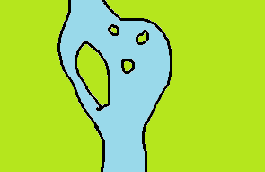

# RIVER — Design Pillars

*Bad Ideas Works · v0.2 · 2026-11-23 · with notes from Noor*
*Engine: Godot 4.7.2 · C# · Forward+*

> One raft. One river. It does not end.

This document sets the direction: what the game **is**, what it **feels like**, and which engineering decisions
follow from that. It is meant to be argued with. Everything marked **OPEN** is still undecided.

---

## 1. The one-sentence pitch

A slow, beautiful and quietly unsettling expedition down an endless, realistically generated river around 1890.
You live on an upgradeable raft, go ashore to forage, hunt, fish and explore, and fill a field journal with a
world nobody has mapped.

---

## 2. Atmosphere & references

| Reference | What we take from it |
|---|---|
| **Greystoke: The Legend of Tarzan** (1984, Christopher Lambert) | Victorian civilisation against vast, indifferent, beautiful wilderness. Animals as presences, not loot. Melancholy. |
| **The Secret Garden** (1993, Agnieszka Holland) | Mist, moors, stone walls swallowed by overgrowth, hidden places. Seasons as change: grey winter, then a spring that bursts out. Preisner's sparse, aching score. |
| **Curious Expedition** (game) — *but darker* | The 1880s expedition fantasy: sponsors, a journal, fame for what you bring back, a creeping loss of composure in the unknown, discoveries that can go wrong. |
| *Heart of Darkness* (Conrad, 1899), *Aguirre*, *Fitzcarraldo* | The darker half: isolation, fever, rotting outposts, the feeling that the river is taking you somewhere you shouldn't go. |
| Historical: Klondike 1898 rafts, Mississippi shantyboats, river naturalists (Bates, Wallace) | The grounded reality: home-built rafts, river people, specimen collecting, maps with blank spaces. |

**Tone in one line:** *beautiful first, ominous second, cruel rarely.*
Wonder is the default. Dread builds slowly, from distance travelled, isolation, weather and what you find, never
from cheap jump scares. Survival matters but is texture, not a stat-management grind.

**Era:** fictional continent, technology and culture around **1885–1905**. Rifles, kerosene lanterns, sweep oars,
canvas, brass instruments, glass plate cameras (maybe), steamboats on the lower reaches, telegraph only near
towns. No GPS, no reliable maps.

**OPEN:** how far the dark goes — purely natural (disease, madness, human cruelty), or a faint hint of the
uncanny that is never confirmed?

---

## 3. Pillars

Every feature must serve at least one pillar. A feature that serves none gets cut, however fun the idea sounds
in a meeting.

### P1 — The river is the main character
It must be the best-looking and best-feeling thing in the game. It's not a ribbon with bends: it widens into
lakes, splits around islands, braids across gravel, breaks into rapids, drops over falls and dissolves into
labyrinths of islets. Every hour on it should look different from the last.

### P2 — Realistic, readable geography
Shapes follow real fluvial rules (meander wavelength scales with width, cut banks on the outside of bends, point
bars on the inside, oxbows left behind by cutoffs, rivers widening after every confluence). A player who knows
rivers should nod. A player who doesn't should still *learn to read* the water: where it's deep, where it's fast,
where you'll run aground.

### P3 — An effectively endless journey
Not "big map", but *you will never reach the end*. The world is generated deterministically from a seed as you
travel. The journey has an arc (cold misty highlands → temperate forests → lush humid jungle) but never stops.

### P4 — The raft is home
Walk the deck while it drifts. Build onto it, repair it, live on it. Moor at the bank and step off. The raft is
your base, your vehicle and your character's whole world.

### P5 — Wonder, then unease
Quiet discoveries first: a walled garden on the bank, a sunken steamboat, a herd crossing at dawn. Over distance
and time, the world gets stranger and the player more fragile. Composure is a resource.

### P6 — The naturalist's journal
You are recording, not conquering. Sketch species, press plants, log fish, chart the river. The journal is the
progression system, the map and the souvenir of your run.

### P7 — A tiny, warm, human place *(Noor)*
The player should be **emotionally attached** to the raft, not just mechanically dependent on it. Small daily
rituals (opening the canvas flap to the mist, putting water on the stove, rearranging specimens, fixing a loose
plank) and keepsakes brought back from the shore slowly turn it into a cluttered floating museum of the journey.
**The contrast between the familiar raft and the unfamiliar world is the atmosphere.**

### P8 — Places worth staying *(Noor: the Secret Garden feeling)*
Not every discovery is a ruin, a threat or a clue. Sometimes you push through an overgrown archway into somewhere
breathtaking: a pool beneath a waterfall, a valley of flowers, a forgotten orchard, a clearing full of deer.
**No reward notification. No quest.** Just somewhere you want to stay a while. The journey is infinite, but the
best moments might be the ones when you decide not to go anywhere.

---

## 4. The river — feature catalogue



*Tom's sketch #1: the river opens into a wide river-lake with one large island (a channel on each side) and
small islets, then narrows again. **This is the standard**: water bodies with real shape and topology, not a
channel with constant width.*

### 4.1 Channel forms (changing along the river)
| Form | What it is | Gameplay |
|---|---|---|
| **Meandering** | Single channel, sweeping bends; fast deep water on the outside (*thalweg*), shallow sandy *point bars* inside | Choose your line; read the water |
| **Straight / gorge** | Narrow, fast, confined by rock walls | Tension, speed, no landing spots |
| **Braided** | Many shallow channels weaving over gravel bars that shift with floods | Grounding risk, scouting, poling |
| **Anabranching** | A few stable channels separated by large forested islands | Real route choices that rejoin later |
| **River-lake** (sketch #1) | The river opens into a wide, slow, lake-like basin with islands | Calm, wind and waves matter more than current; fishing |
| **Island labyrinth** | Dozens to hundreds of islets and narrow passages (think Anavilhanas, Thousand Islands, delta backwaters) | Getting lost, dead ends, hidden places, mist |
| **Floodplain wetland** | Backwaters, reeds, flooded forest beside the main channel | Wildlife, hunting, mosquitoes, fever |

### 4.2 Features
- **Islands:** sandbars (temporary, change with season), gravel bars, forested islands, rocky islets.
- **Oxbow lakes & meander scars:** abandoned channel loops beside the river. Good fishing, wildlife, eerie.
- **Tributaries & confluences:** side rivers join from both banks. The main river visibly grows after each one.
  Water colour can differ (clear meets muddy, black meets white) and mix downstream.
- **Rapids:** graded by severity. Run them, line the raft down with ropes from the bank, or portage.
- **Waterfalls & cascades:** rare, major events. The raft can't go over them, so you **portage** or **line it
  down**: a slow, physical set piece. A waterfall marks a "chapter".
- **Gorges:** fast, dark, loud. No stopping.
- **Snags:** sunken trees, historically the great killer of river boats. Visible if you read the surface.
- **Backwaters & eddies:** calm water behind points and islands: places to moor, fish, shelter.

### 4.3 The river changes with time
- **Seasons:** spring flood (fast, high, debris), summer, autumn low water (sandbars exposed, grounding),
  winter **freeze-up**, which forces a winter camp ashore.
- **Weather:** fog in the mornings, wind waves on wide reaches, storms, rain raising the level.
- **Day/night:** drifting at night is possible but dangerous.

---

## 5. World generation — river first

Thornwake generates terrain first and lets water find its way. For an endless river we **invert** that:

```
seed
 └─ 1. River graph        (segments generated ahead of the player, deterministic per segment index)
     └─ 2. Water levels   (piecewise: flat reaches separated by rapids/falls; lakes are flat)
         └─ 3. Water shape (2D signed distance field: channels, islands, lakes, labyrinths)
             └─ 4. Flow field (direction + speed everywhere on the water)
                 └─ 5. Valley  (floodplain, terraces, banks, gorge walls shaped around the water)
                     └─ 6. Terrain, biomes, vegetation, props (Thornwake systems, constrained by the valley)
```

**1. River graph.** The main river is a chain of **segments** (≈1–5 km each). Each segment has a *type* (from
§4.1), an accumulated drainage area, and physically derived width, depth, slope and meander wavelength. Channels
can split and rejoin within a segment (anabranching, braiding, island labyrinths). Tributaries are smaller
branches with their own drainage area. Every segment is a pure function of `(seed, index)`, so saves stay tiny
and the river is the same on every PC.

**2. Water levels.** The water surface is a set of **reaches** at nearly constant level, linked by gentle slopes,
rapids or falls. This makes lakes flat, falls clean, and it lets the elevation drop level off so the river never
needs to reach the sea.

**3. Water shape.** Inside the generation corridor, the water is a 2D **signed distance field** built from the
graph: channel ribbons, lake basins, islands subtracted. This is what lets us make sketch #1 and the labyrinths,
which a "spine + width" model cannot.

**4. Flow field.** Simple channels get flow straight from the spine. For lakes, islands and labyrinths we solve a
cheap **potential flow** on the local water grid between inlet and outlet, so current naturally splits around
islands, speeds up in narrows and goes slack in bays. The same field drives water rendering, foam, raft physics,
debris and fish.

**5–6. Valley and land.** Banks (cut banks, point bars), floodplain, terraces and valley walls are shaped around
the water. Then Thornwake's terrain noise, biomes, vegetation and props fill in the rest, never contradicting the
river.

**Climate arc.** Distance downstream drives a slow climate shift: highlands and moors → mixed temperate forest →
warm wetlands → humid jungle. Endless variety inside each zone, a sense of travel across zones.

**River coordinates.** Everything near the water can be expressed as `(s, t)` = distance along the river, offset
across it. These drive flow, sandbars, fish habitat, the map and the journal.

---

## 6. The raft

- **Start:** a crude log raft with a sweep oar and a pole.
- **Grows into:** a **shantyboat**-style home: cabin, stove, storage, drying racks, smoking rack, workbench,
  rain catchment, maybe a small sail or a dinghy for scouting.
- **Physics:** buoyancy plus drag in the flow field. Weight and layout matter (overloading, listing).
- **Control:** sweep oar (steering), poles (shallows), paddles, anchor, mooring lines. No engine (**OPEN**: a
  late-game salvaged steam launch?).
- **Damage:** hull logs, lashings, leaks. Repairs need materials from the shore.
- **Walking on deck while moving** is a hard requirement: the player character is simulated in the raft's frame.

### 6.1 Domestic life (P7)
- **Rituals, not chores.** Small optional interactions with no or tiny mechanical value: open the flap, boil the
  kettle, wind the pocket watch, tap the barometer, hang washing, light the lantern at dusk, sweep the deck, tie
  down loose things before a storm. Doing them restores a little composure. Skipping them never punishes you.
- **The raft wears your life.** Clutter accumulates naturally: drying fish, muddy boots by the door, open journal
  on the table, a mug left on the rail. Wear and patches show its history.
- **Keepsakes.** Anything beautiful found ashore can be brought back and **placed freely** on the raft: a carved
  figure, a painting from a deserted house, a potted plant (which keeps growing, and needs watering), a skull,
  a music box, a stuffed bird. Shelves, hooks, walls and deck space are yours to arrange. No stat bonuses by
  default; their value is that you remember where each one came from (the journal does too).
- **Warm vs. wild.** Lighting, sound and colour inside the cabin are deliberately warm and close: lantern glow,
  stove crackle, rain on canvas. Step outside and the scale of the wilderness hits again.
- **Engineering note:** keepsakes are physical objects with transforms saved in raft space; they must survive
  rough water (secured vs. loose items that can slide, fall or go overboard: a small heartbreak, used sparingly).

---

## 7. The land

- Streamed in a **corridor** a few kilometres either side of the water, with real valley walls and distant
  horizon scenery beyond. Large enough to wander, hunt and get lost in, with natural boundaries.
- **On shore:** foraging, hunting, gathering wood and fibre, campsites, ruins, abandoned outposts, river
  settlements, trading posts, the occasional overgrown walled garden.

### 7.1 Secret places (P8)
- A dedicated **site type** in world generation: compositions of terrain, water, vegetation, light and wildlife
  tuned for beauty (waterfall pool, flower valley, forgotten orchard, deer clearing, fern grotto, still oxbow at
  dawn, hot spring in snow, ancient tree…). Deliberately **hidden**: behind an overgrown arch, up a side stream,
  over a ridge.
- **Silence is the reward.** No popup, no XP, no quest marker, no map icon unless the player chooses to draw it
  in the journal. Music may arrive gently, or not at all.
- **Staying is supported.** You can camp, moor nearby, sit, sketch, fish. Time passes beautifully (light,
  animals, weather change). Nothing in the game ever forces you to leave except seasons and your own supplies.
- **Design rule:** no system (sponsor deadlines, timers, threats) may pressure the player into constant movement.
  The river is endless; there's no hurry.
- **Rarity matters.** Too frequent and they become content. They should feel like luck.

---

## 8. Survival & the expedition

- **Body:** hunger, thirst (boil river water!), warmth, fatigue, illness (fever, infections, bad food).
- **Composure:** isolation, darkness, injuries, disturbing finds and bad weather wear it down. Good food, fire,
  company and beauty restore it. Low composure distorts the journal, the sounds, the world. (Curious Expedition's
  sanity, but slower and quieter.)
- **Fishing:** a core system. Species depend on water type (fast/slack, clear/muddy, depth, temperature).
- **Hunting:** present, never the point. Animals have behaviour and dignity.
- **Expedition layer (OPEN):** a sponsoring society back home. Send journal pages, specimens and maps downriver
  by steamer mail for fame, money and supplies. Do you even want to go home?

---

## 9. The journal

The core progression and the souvenir of the run.

- **Species:** sketch (observe long enough), collect, press, preserve.
- **Map:** hand-drawn as you travel. Only what you've seen gets charted, and it can be wrong.
- **Entries:** written automatically from events in a period voice, distorted by low composure.
- **Collections:** artefacts, photographs (**OPEN**), notes on the people you meet.

---

## 10. Audio direction
Mostly the river: flow, lapping, creaking timber, rope, birds, insects, rain on canvas. Music is rare and
sparse (piano, strings, woodwinds, Preisner-like), arriving at moments: a sunrise, a waterfall, a grave.

## 11. Visual direction
Painterly naturalism. Soft diffuse light, river mist, volumetric fog and light shafts, wet banks, strong
water reflections (screen-space reflections in Forward+), restrained colour grading per climate zone. Beauty
that slowly becomes heavy and humid as the journey goes on.

---

## 12. Technology

- **Godot 4.7.2, C#, Forward+.**
- **Reuse from Thornwake_Rewrite** (adapted): chunk streaming, ground textures, flora/grass, sky/clouds/
  atmosphere, weather, light beams, colour grading, game clock, character controller, fishing/hunting/building
  foundations.
- **Do not reuse:** Thornwake's whole-world hydrology solver. It is replaced by the river-first pipeline (§5).
- **New core systems:** river graph, water level reaches, water SDF, potential flow solver, river mesh +
  flow-driven water shader, raft buoyancy/flow physics, moving-platform character controller.
- **Determinism:** world = f(seed). Only player changes are saved.
- **Floating origin:** required. An endless river gets far from (0,0,0) quickly.
- **Code standard:** studio motto #001. Understandable to whichever AI inherits this mess.

---

## 13. First prototype — "Does drifting feel amazing?"

No survival, no UI. Just the river.

1. River graph + water SDF for a few km: meanders, one tributary, one river-lake with islands (sketch #1).
2. Terrain shaped around it (simple, placeholder vegetation).
3. Water rendering: depth colour, flow-driven normals and foam, reflections.
4. A raft that floats and drifts in the flow field, steered with a sweep oar.
5. First-person walking on the deck while drifting, mooring, stepping onto the bank.

**Success test:** Tom drifts for 15 minutes with no goal and doesn't want to stop.

Then: rapids & a waterfall portage → island labyrinth → fishing → raft building & domestic life (cabin, stove,
first keepsake shelf) → first secret place → survival → journal → expedition layer.

---

## 14. Open questions

1. **Scale & time:** real 1:1 distances (raft ≈ 4–8 km/h, slow and contemplative), or compressed distance so
   landscapes change faster?
2. **Solo, crew of NPC companions, or co-op?** (Curious Expedition has a crew; Thornwake has networking.)
3. **How dark** does it get, and is there any hint of the uncanny?
4. **Is there a goal?** Pure endless journey, a mystery downstream, or a sponsor's expedition with "chapters"?
5. **Death:** permadeath roguelike runs (Curious Expedition) or one persistent journey?
6. **Who is the player?** A naturalist, a disgraced explorer, a widow following a lost husband's map…?
7. **Downstream only?** Heart of Darkness goes *upstream*. Do we ever allow long trips up tributaries?

---

*Bad Ideas Works — where bad ideas receive suspiciously serious engineering.*
